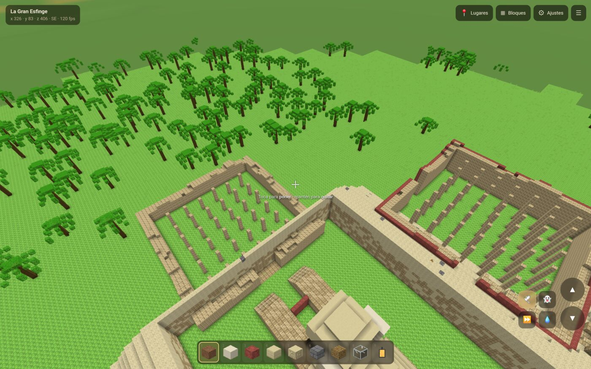
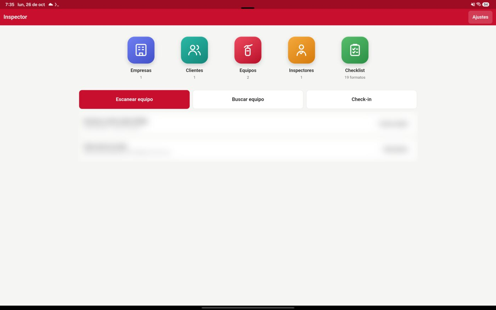
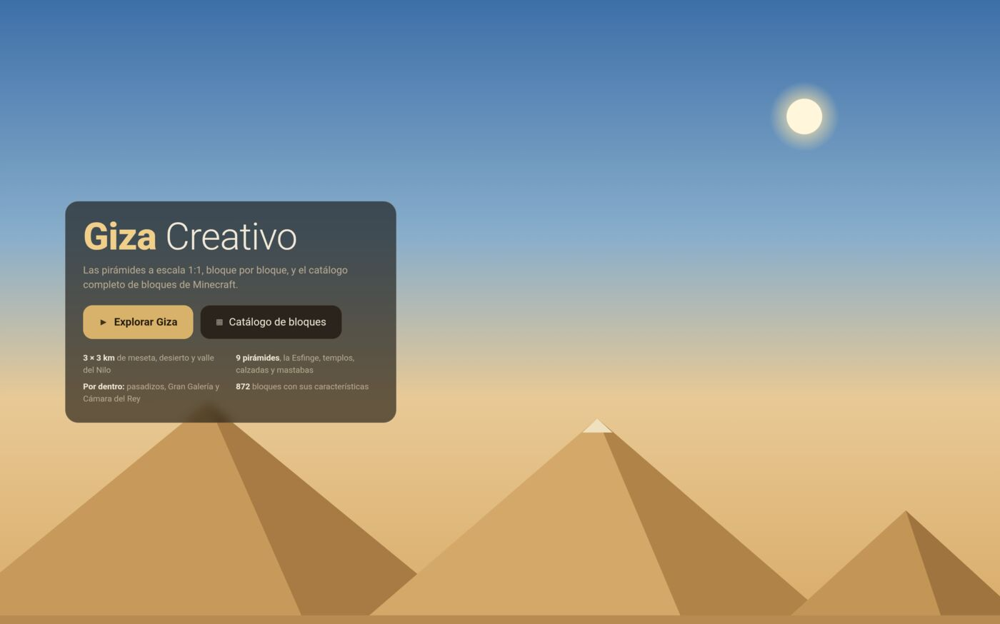
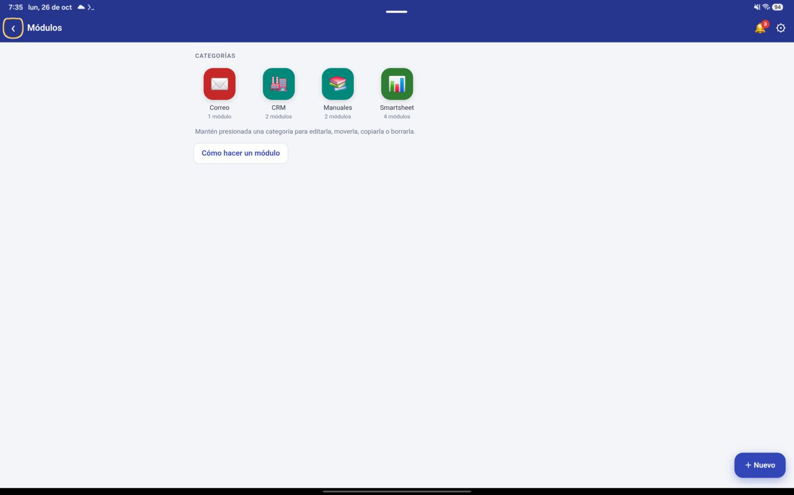
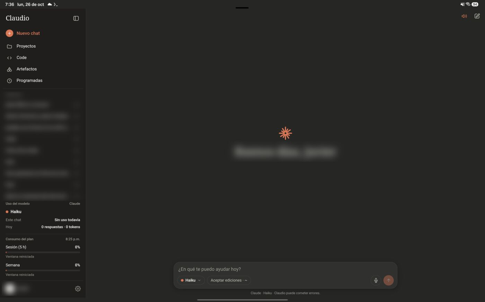

# Apps Android hechas, compiladas e instaladas desde la misma tablet

Sin computadora y sin Android Studio. Le pido la app a Claude Code en Termux, se compila ahí mismo en segundos y se instala por depuración inalámbrica en la propia tablet. Después se prueba en pantalla por adb.

**Equipo:** Samsung Galaxy Tab S10 Ultra (SM-X920) · Termux · Claude Code · adb inalámbrico

| Compilar Giza Creativo de cero | Instalarla por adb inalámbrico | APK firmado |
|---|---|---|
| **2.9 s** | **336 ms** | **79 KB** |



*Giza Creativo corriendo en la tablet, minutos después de compilarse e instalarse desde Termux. Los números de arriba son de esa misma corrida (26 de octubre de 2026).*

## De la idea a la app instalada

### 1. Pedir la app

Le explico a Claude qué quiero, en español y con mis palabras: «una app para mis inspecciones contra incendio», «un juego tipo Minecraft con las pirámides de Giza». Claude escribe el proyecto completo en una carpeta de Termux.

### 2. Una forma de app que sí compila en Termux

Gradle no corre bien en Termux, así que todas las apps siguen el mismo molde: una **WebView** que muestra HTML, CSS y JavaScript, y un **puente en Java** para lo que necesita el teléfono: SQLite, cámara, ubicación, archivos o PDF.

```
AndroidManifest.xml
assets/        # la interfaz: index.html, app.js, estilos
java/          # MainActivity + el puente con Android
res/           # ícono y recursos
build.sh       # compila y firma
```

### 3. Compilar con las herramientas de Android

Un `build.sh` de 20 líneas llama directo a las mismas herramientas que usa Android Studio por dentro:

**aapt2 → javac → d8 → zip → apksigner**

```bash
# paquetes de Termux
pkg install aapt2 d8 apksigner openjdk-17 android-tools
# y un android.jar (API 36) en ~/android-sdk

$ bash build.sh
build/GizaCreativo.apk   79 KB
real  0m2.896s
```

### 4. Conectar la depuración inalámbrica a la propia tablet

En *Opciones de desarrollador → Depuración inalámbrica* se toca «Vincular con código». Termux hace de computadora y se conecta a la misma tablet por la red Wi-Fi.

```bash
adb pair 192.168.1.x:PUERTO_DE_VINCULAR CODIGO
# ojo: el puerto de conexión casi nunca es el que muestra la pantalla;
# se buscan los puertos abiertos y se usa el nuevo
adb connect 192.168.1.x:PUERTO_REAL
adb devices
```

### 5. Instalar y probar

Con adb conectado, Claude instala la app, la abre, toma capturas de pantalla y las revisa. Si algo se ve mal, corrige el código, vuelve a compilar y repite.

```bash
adb install -r build/GizaCreativo.apk      # Success · 336 ms
adb shell monkey -p PAQUETE 1              # abrir la app
adb exec-out screencap -p > captura.png    # Claude la mira
adb shell pm grant PAQUETE PERMISO         # dar permisos sin tocar
adb shell pm clear PAQUETE                 # borrar datos y empezar de cero
```

Para revisar lo que pasa dentro de la WebView, la app se compila en modo depuración y adb abre un túnel a sus DevTools. Así Claude puede leer errores y ejecutar JavaScript dentro de la app mientras corre.

## Lo que ya salió de aquí

### Inspector


Inspecciones contra incendio para reemplazar AppSheet. Tiene 19 formatos de checklist, escaneo de equipos, check-in con ubicación, firma y fotos. Guarda todo en el teléfono y sincroniza con un servidor propio.

### Giza Creativo


Juego de bloques en modo creativo: la meseta de Giza de 3 × 3 km a escala 1:1, nueve pirámides con pasadizos por dentro y 872 bloques con texturas dibujadas por código.

### Módulos


Corre pantallas HTML que se pegan en una carpeta, sin volver a compilar, organizadas por categorías. Cada formulario tiene su propia tabla en SQLite.

### Claudio


Una interfaz propia para platicar con Claude y otros asistentes que corren en Termux, con voz y consumo del plan a la vista.

## Trampas del camino

- **El puerto de la pantalla engaña.** El puerto que muestra Depuración inalámbrica no siempre es el que acepta la conexión. Después de vincular hay que buscar los puertos abiertos (entre 30000 y 50000) y conectarse al que aparece nuevo. `adb mdns services` también puede mostrarlo.
- **La IP cambia.** Cada red o cada reinicio puede dar otra IP. Antes de conectar, hay que revisar cuál tiene la tablet.
- **Cuida la llave de firma.** Si se pierde el `keystore`, la siguiente versión ya no se instala encima de la anterior y hay que desinstalar, con todo y datos. Conviene respaldarla fuera del aparato.
- **Gradle no es opción.** Los proyectos con Gradle y Android Gradle Plugin no compilan en Termux. Llamar directo a aapt2, javac y d8 es lo que hace que todo funcione aquí.
- **Nada de ventanas del navegador.** Los `alert` y `confirm` de una WebView salen con «La página … dice». Se ven feos, así que cada app usa ventanas propias.

## Lo que hay en GitHub

Encontré proyectos que cubren partes del camino, pero ninguno junta todo: un asistente de IA que escribe la app, la compila en el mismo Android sin Gradle, la instala por depuración inalámbrica y la revisa con capturas.

- [buildAPKs](https://github.com/BuildAPKs/buildAPKs.keyboards) y [termux-buildapk](https://github.com/TheDiamondYT1/termux-buildapk): scripts para compilar APKs en Termux.
- [Bacol](https://community.e.foundation/t/bacol-build-apks-from-the-command-line-aka-bacol/20891): los mismos pasos aapt2, javac y d8, pero pensado para computadora.
- [claude-code-android](https://github.com/ferrumclaudepilgrim/claude-code-android): guía para correr Claude Code en Android, con una sección de adb hacia el mismo aparato.

---

Capturas tomadas por adb en la tablet el 26 de octubre de 2026. Se difuminaron nombres, conversaciones y datos de cuenta.
